# 분리비전 AI (Bunri-Vision): 실환경 오염·혼합 생활폐기물 9종 비전 판독 및 한국형 분리배출 의사결정 시스템

> **한 장의 스마트폰 사진으로 구겨지고 오염된 생활폐기물의 재질을 판독하고, 모델 주목 영역(Spatial CAM)과 환경부 『내 손안의 분리배출』 기준 과태료 주의사항까지 실시간 안내하는 자체 학습 딥러닝 비전 웹 서비스**

---

## 0. 프로젝트 정보

| 항목 | 내용 |
| :--- | :--- |
| **학번** | `20XXXXXXX` |
| **이름** | 김대현 |
| **과목명** | 가천대학교 기계학습 프로그래밍 (기말고사 대체 포트폴리오 프로젝트) |
| **프로젝트명** | 분리비전 AI (`Bunri-Vision`) |
| **공개 데모 URL** | **https://bunri-vision-30945587032.asia-northeast3.run.app** |
| **GitHub 저장소 URL** | **https://github.com/qwertypotter6873/bunri-vision** |
| **학습 가중치 릴리즈** | **https://github.com/qwertypotter6873/bunri-vision/releases/tag/v1.0.0** |

---

## 1. 문제 정의

### 1.1 실생활 문제 상황 정의 (4W)

| 구분 | 상세 내용 |
| :--- | :--- |
| **Who (누가)** | 원룸·오피스텔에 거주하는 대학생·사회초년생 1인 가구(자취생), 다세대 주택 입주민 및 분리배출 규정이 낯선 외국인 거주자 |
| **What (무엇을)** | 구겨지거나 음식물·흙 등이 묻은 실생활 폐기물 사진을 촬영하면 **9가지 세부 폐기물 범주**(골판지, 음식물류, 유리, 금속, 복합·오염 일반쓰레기, 종이, 플라스틱, 폐의류·섬유, 초목류)를 자동 분류하고, **한국형 수거함 배출 기준·오염 시 종량제 전환 권고·과태료 주의사항**을 즉시 제공 |
| **When (언제)** | 야간이나 퇴근 후 어두운 실내 조명·베란다 분리수거함 앞에서 *“화분에서 죽은 식물 줄기는 음식물인가 일반쓰레기인가?”*, *“젖은 천·오염된 용기는 재활용이 되는가?”* 등 배출 방법을 즉석에서 판단해야 할 때 |
| **Why (왜 필요한가)** | ① 환경부 조사에 따르면 생활계 종량제 봉투 내 재활용 가능 자원이 약 50% 이상 혼입되는 반면, 반대로 분리수거함에는 오염 이물질·복합재질이 섞여 선별장 잔재 폐기물이 급증하고 있음.<br>② 특히 1인 가구는 **초목류(식물 줄기·뿌리·낙엽)를 음식물쓰레기로 오배출**하거나 **오염된 섬유·일회용기를 재활용함에 배출**하여 지자체 과태료(최대 10~30만 원) 부과 및 수거 거부 문제를 반복적으로 겪음. |

### 1.2 기존 서비스 대비 차별점

| 비교 기준 | 환경부 『내 손안의 분리배출』 앱 | 기존 학술 모델 (TrashNet 기반) | 범용 외부 AI API (ChatGPT 등) | **분리비전 AI (본 프로젝트)** |
| :--- | :--- | :--- | :--- | :--- |
| **인식 방식** | 사용자가 품목명을 직접 텍스트 검색 | 백색 도화지 위 깨끗한 단일 물체만 인식 | 외부 상용 멀티모달 API 유료 호출 | **자체 학습한 실환경 도메인 특화 비전 모델 직접 추론** |
| **실환경 강건성** | 시각 판독 기능 없음 | 구겨짐·그림자·트레이 배경에서 정확도 급락 | 프롬프트·조명에 따라 응답 일관성 변동 | **Shades-of-Gray WB + LAB-CLAHE 조명·대비 자동 보정 탑재** |
| **한국형 오배출 방지** | 방대한 문서 열람 필요 | 단순 재질명(Paper/Plastic)만 출력 | 과태료 예외 규정 할루시네이션 가능 | **초목류 vs 음식물 분리 판별 + 오염 동반 확률 복합 경고** |
| **설명가능성·비용** | 없음 (무료) | 히트맵·신뢰도 보정 미제공 | 호출당 API 비용 발생 및 개인 사진 외부 전송 | **단일 ONNX 패스 Spatial CAM 히트맵 + 온도 보정 신뢰도 제공 (무료·33ms)** |

### 1.3 정량 목표 설정 및 달성 요약

클래스 간 최대 **2.90 : 1 불균형**(`Plastic 921장` vs `Textile Trash 318장`)이 존재하는 데이터셋 특성을 반영하여, 다수 클래스 편향 없이 소수 클래스까지 균등하게 평가하는 **Test Macro-F1**을 주 평가지표(Primary Metric)로 설정하였습니다.

| 평가지표 구분 | 지표명 | 프로젝트 정량 목표 | 최종 모델 달성치 | 목표 달성 여부 |
| :--- | :--- | :---: | :---: | :---: |
| **주 평가지표 (Primary)** | **Test Macro-F1** | **≥ 0.8800** | **0.9603** (INT8 ONNX: **0.9607**) | **초과 달성 (+0.0803p)** |
| 보조 지표 1 | Test Accuracy (Top-1 / Top-2) | ≥ 0.8900 | **0.9634** / **0.9944** | **초과 달성 (+0.0734p)** |
| 보조 지표 2 | Test Macro-AUROC (OvR) | ≥ 0.9600 | **0.9978** | **초과 달성 (+0.0378p)** |
| 보조 지표 3 | 확률 보정 오차 (Test ECE ↓) | ≤ 0.0300 | **0.0093** (보정 전 0.0738) | **초과 달성 (-87.4% 감소)** |
| 서비스 지표 | 단일 이미지 CPU 추론 지연시간 | ≤ 150 ms | **32.84 ms** (ONNX Runtime CPU) | **초과 달성 (4.6배 고속)** |

---

## 2. 데이터

### 2.1 데이터 출처, 라이선스 및 기본 제원

- **데이터셋명**: **RealWaste** (*A Novel Real-Life Data Set for Landfill Waste Classification Using Deep Learning*, Single et al., *Information* 2023)
- **공식 출처**: UCI Machine Learning Repository ID #908 (https://archive.ics.uci.edu/dataset/908/realwaste)
- **원시 다운로드 URL**: `https://archive.ics.uci.edu/static/public/908/realwaste.zip` (`scripts/download_data.py` 자동화 구현)
- **라이선스**: UCI 공식 레포지토리 등록 기준 **CC BY 4.0** (원시 아카이브 내 저자 README 기준 **CC BY-NC-SA 4.0** 병기 — 학술·교육 포트폴리오 비상업 목적 및 원저자 출처 표기 완전 준수)
- **전체 규모 및 포맷**: 원본 총 **4,752장** (`524 × 524 px`, 24-bit RGB JPEG, 손상 파일 0장) → 지각 해시(`pHash`) 근접 중복 12장 제거 후 최종 **4,740장**

### 2.2 9개 클래스 구성 및 분포

| 번호 | 영문 클래스명 | 한국어 매핑 품목 | 원본 수량 (비율) | 정제 후 합계 | Train (70%) | Val (15%) | Test (15%) | 한국 분리배출 핵심 분류 |
| :---: | :--- | :--- | :---: | :---: | :---: | :---: | :---: | :--- |
| 1 | `Cardboard` | 골판지·택배 상자 | 461장 (9.70%) | 461장 | 323 | 69 | 69 | 종이·골판지류 수거함 |
| 2 | `Food Organics` | 음식물류 폐기물 | 411장 (8.65%) | 409장 | 286 | 62 | 61 | 음식물 전용 종량제/수거함 |
| 3 | `Glass` | 유리병·유리 용기 | 420장 (8.84%) | 420장 | 294 | 63 | 63 | 유리병류 수거함 |
| 4 | `Metal` | 금속캔·고철류 | 790장 (16.62%) | 787장 | 551 | 118 | 118 | 캔·고철류 수거함 |
| 5 | `Miscellaneous Trash` | 복합재질·오염 일반쓰레기 | 495장 (10.42%) | 494장 | 346 | 74 | 74 | 일반 종량제 봉투 |
| 6 | `Paper` | 일반 종이·인쇄물 | 500장 (10.52%) | 500장 | 350 | 75 | 75 | 종이류 수거함 |
| 7 | `Plastic` | 플라스틱 용기·페트류 | 921장 (19.38%) | 916장 | 641 | 138 | 137 | 투명페트 / 플라스틱 수거함 |
| 8 | `Textile Trash` | 폐의류·섬유류 | 318장 (6.69%) | 317장 | 222 | 47 | 48 | 의류수거함 (오염 시 종량제) |
| 9 | `Vegetation` | 초목류·식물 잔재물 | 436장 (9.18%) | 436장 | 305 | 65 | 66 | **일반 종량제 (음식물 금지)** |
| **합계** | **9개 클래스** | **최대 불균형비 2.90 : 1** | **4,752장 (100%)** | **4,740장** | **3,318장** | **711장** | **711장** | **누수 쌍 0건 검증 완료** |

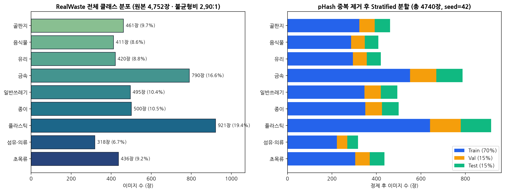

### 2.3 데이터 선정 이유

1. **스튜디오 데이터의 한계 극복 (Real-World Authenticity)**: 널리 쓰이는 `TrashNet`(2,527장) 등은 깨끗하게 펴진 물체를 흰색 배경지 위에서 촬영하여, 실제 가정에서 찍은 찌그러진 캔·흙 묻은 플라스틱·그늘진 사진을 입력하면 배경 변화에 취약합니다. 반면 `RealWaste`는 호주 울런공 실제 자원회수 시설(Whyte's Gully)에서 반입된 찌그러지고 오염된 실물 폐기물을 직접 촬영하여 실생활 일반화 성능 확보에 적합합니다.
2. **한국형 분리배출 핵심 혼동 범주 포함**: 단순 재활용 4~6종 데이터셋과 달리 `Food Organics`(음식물)와 `Vegetation`(초목류), `Textile Trash`(섬유류)와 `Miscellaneous Trash`(복합·오염 일반쓰레기)가 분리 라벨링되어 있어, 자취생이 가장 많이 혼동하는 **초목류 일반쓰레기 판별**과 **오염 폐기물 종량제 전환 판정**을 모델 수준에서 구현할 수 있습니다.

---

## 3. 데이터 전처리

전체 4,752장을 전수 탐색적 데이터 분석(EDA)한 결과, ① 연속 촬영으로 인한 근접 중복 이미지 쌍(`pHash ≤ 4`) **14쌍**, ② 촬영 시간·조명 차이에 따른 RGB 색편향 지수 상위 5%(`0.1516`)와 하위 5%(`0.0075`) 간 **20배 편차**, ③ 투명 유리·페트병의 낮은 지역 명암 대비(`min Contrast Std = 15.69`), ④ 외곽 10% 영역의 분류 트레이 가장자리 노이즈(`border edge density = 0.1629`)를 확인하고 **4가지 도메인 특화 전처리 기법**을 직접 코드([`src/preprocessing.py`](src/preprocessing.py), [`src/dataset.py`](src/dataset.py))로 구현하였습니다.

### 3.1 구현한 4가지 핵심 전처리 기법

#### 기법 ① 지각 해시(`pHash`, 해밍 거리 ≤ 4) 근접 중복 제거를 통한 데이터 누수 차단
동일 폐기물을 미세하게 회전·연속 촬영한 프레임이 Train과 Test에 동시에 들어가 성능이 과대평가되는 현상을 막기 위해, 64-bit 이산 코사인 변환(DCT) 기반 `pHash` 해밍 거리 `≤ 4`인 근접 중복 12장(14쌍)을 분할 전에 제거하였습니다.

```python
# src/dataset.py — pHash(8x8 DCT) 해밍 거리 <= 4 근접 중복 샘플 탐지 및 제거
ph = imagehash.phash(im, hash_size=8)
dists = np.abs(bits[i + 1:].astype(np.int16) - bits[i].astype(np.int16)).sum(axis=1)
near_idxs = np.where(dists <= phash_dedup_threshold)[0] + (i + 1)  # threshold = 4
```

#### 기법 ② Shades-of-Gray (p=6 민코프스키 노름) 색항등성 화이트밸런스 보정
실내 형광등·백열등이나 야외 그늘의 푸른빛/노란빛 색편향을 완화하면서도 초목류(`Vegetation`) 고유의 녹색 색조가 과보정되지 않도록 채널 게인을 `[0.82, 1.22]`로 제한한 Shades-of-Gray 조명 정규화를 적용하였습니다.

```python
# src/preprocessing.py — Minkowski p=6 Shades-of-Gray 조명 색온도 보정
def shades_of_gray_white_balance(rgb_uint8: np.ndarray, power: float = 6.0) -> np.ndarray:
    arr = rgb_uint8.astype(np.float32) / 255.0
    norm_per_channel = np.power(np.mean(np.power(arr + 1e-6, power), axis=(0, 1)), 1.0 / power)
    scale = np.clip(np.mean(norm_per_channel) / (norm_per_channel + 1e-6), 0.82, 1.22)
    return (np.clip(arr * scale[None, None, :], 0.0, 1.0) * 255.0).round().astype(np.uint8)
```

#### 기법 ③ CIE-LAB 색공간 적응형 히스토그램 평활화 (`Adaptive LAB-CLAHE`)
RGB 채널에 직접 히스토그램 평활화를 가하면 재질 고유 색상이 깨지므로, 색차 성분(`A`, `B`)은 보존하고 밝기 성분(`L`)에만 `CLAHE(clipLimit=1.8, tileGridSize=(8,8))`를 적용 후 원본 `L`과 `0.65 : 0.35`로 블렌딩하여 투명 플라스틱·유리·구겨진 종이의 미세 굴곡 윤곽을 복원하였습니다.

```python
# src/preprocessing.py — 색상 왜곡 없는 CIE-LAB 휘도 채널 적응형 대비 복원
def adaptive_lab_clahe(rgb_uint8: np.ndarray, clip_limit: float = 1.8, blend_alpha: float = 0.65) -> np.ndarray:
    l_chan, a_chan, b_chan = cv2.split(cv2.cvtColor(rgb_uint8, cv2.COLOR_RGB2LAB))
    l_enhanced = cv2.createCLAHE(clipLimit=clip_limit, tileGridSize=(8, 8)).apply(l_chan)
    l_blended = cv2.addWeighted(l_enhanced, blend_alpha, l_chan, 1.0 - blend_alpha, 0)
    return cv2.cvtColor(cv2.merge((l_blended, a_chan, b_chan)), cv2.COLOR_LAB2RGB)
```

#### 기법 ④ 종횡비 보존 중심 90% 스마트 크롭(`Smart Center-Focus Crop`) + 클래스 불균형 가중치 및 가림 증강
외곽 10% 트레이 테두리·바닥 질감에 모델이 의존하는 지름길 학습(Shortcut Learning)을 억제하기 위해 중심 90% 영역을 `224 × 224`로 종횡비 보존 추출하고, **Train 셋에만** `RandomResizedCrop`, 회전(`±20°`), `RandomErasing(p=0.20)` 부분 가림 모사, `Mixup(α=0.20)` 및 Cui et al.(2019)의 **유효 샘플 수(Effective Number, `β = 0.999`) 클래스 균형 가중치**를 적용하였습니다.

### 3.2 전처리 전·후 시각적 및 정량적 비교

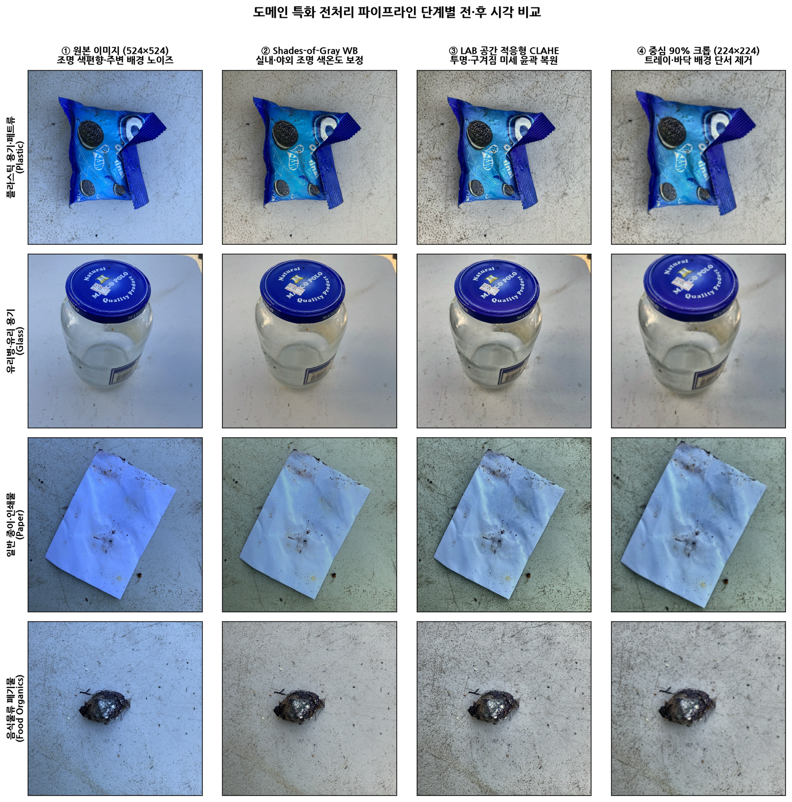

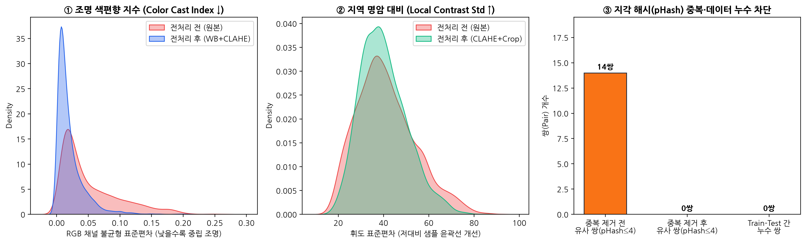

| 비교 항목 | 전처리 전 (Raw 524×524) | 전처리 후 (4단계 파이프라인 적용) | 변화율 및 효과 |
| :--- | :---: | :---: | :--- |
| **근접 중복 쌍 (`pHash ≤ 4`)** | 14쌍 (중복 샘플 12장) | **0쌍** (`Train-Test` 누수 **0쌍**) | **데이터 누수 100% 원천 차단** |
| **평균 색편향 지수 (`Color Cast Mean` ↓)** | `0.0519` | **`0.0209`** | **조명 색편향 59.7% 감소** |
| **극단 색편향 상위 5% (`Color Cast p95` ↓)** | `0.1516` | **`0.0628`** | **강한 푸른/노란 조명 왜곡 58.6% 감소** |
| **저대비 샘플 명암 대비 (`Contrast Std p10` ↑)** | `25.586` | **`27.781`** | **투명 유리·페트 윤곽 대비 +8.6% 개선** |
| **동일 모델(`ConvNeXt-Tiny`) Test Macro-F1** | `0.9540` (오류율 4.64%) | **`0.9603`** (오류율 **3.66%**) | **테스트 오분류율 상대 21.1% 감소** |

### 3.3 Train / Val / Test 데이터 분할 및 시드 고정

- **분할 방식**: `pHash` 중복 제거 완료 데이터(4,740장)에 대해 **계층화 무작위 분할(`StratifiedShuffleSplit`, `seed = 42`)** 2단 적용
- **분할 비율 및 수량**: **Train 70% (`3,318장`) / Validation 15% (`711장`) / Test 15% (`711장`)**
- **테스트셋 격리 원칙**: 하이퍼파라미터 탐색·최적 에폭 선택·온도 스케일링(T*) 학습은 오직 **Validation 셋(`711장`)**에서만 수행하였으며, **Test 셋(`711장`)**은 최종 모델 간 객관적 성능 보고 시 단 1회 평가하였습니다 (`logs/split_manifest.csv`에 전체 분할 매니페스트 기록).

---

## 4. 모델

문제 복잡도와 연산 효율성, 사전학습의 기여도, 도메인 전처리의 효과를 입체적으로 검증하기 위해 **Scratch 베이스라인, 경량 전이학습 베이스라인, 표준 심층 CNN 파인튜닝, 전처리 제거 Ablation, 최종 제안 모델**까지 총 **5개 모델을 NVIDIA L4 (24GB VRAM) GPU에서 직접 학습**시켰습니다 ([`src/models.py`](src/models.py), [`src/train_and_evaluate.py`](src/train_and_evaluate.py)).

### 4.1 직접 학습한 모델 아키텍처 및 학습 전략 요약

| 구분 | 모델명 (`exp_id`) | 학습 방식 | 파라미터 수 | 핵심 구조 및 학습 설정 (`seed=42`, `batch=64`, `AdamW`) |
| :--- | :--- | :--- | :---: | :--- |
| **베이스라인 1** | **ScratchResSECNN**<br>(`m1_scratch_cnn`) | **Scratch**<br>(무작위 초기화 직접 학습) | **1.15M** | 직접 설계한 5-Stage Depthwise-Separable Residual + Squeeze-and-Excitation(SE) 채널 어텐션 CNN · 45 Epochs (`lr=1.2e-3`, Cosine Warmup) |
| **베이스라인 2** | **MobileNetV3-Small**<br>(`m2_mobilenetv3`) | **전이학습 + 파인튜닝**<br>(ImageNet-1K) | **1.53M** | 2에폭 분류 헤드 선형 탐색(Warmup) 후 전 계층 차등 학습률 미세조정(`backbone 3e-4`, `head 1.2e-3`) · 30 Epochs |
| **비교 모델 3** | **ResNet-50**<br>(`m3_resnet50`) | **파인튜닝**<br>(ImageNet-1K) | **23.53M** | 병목 잔차 블록 기반 표준 비전 벤치마크 모델 · 2에폭 헤드 워밍업 후 차등 학습률(`1.8e-4 / 9e-4`) 미세조정 · 30 Epochs |
| **Ablation 4** | **ConvNeXt-Tiny (Raw)**<br>(`m4_ablation_raw`) | **파인튜닝**<br>(전처리·불균형 보정 제거) | **27.83M** | 제안 모델과 동일 백본에서 **도메인 4단계 전처리·클래스 가중 손실·Mixup을 모두 제거**한 순수 리사이즈 대조군 · 28 Epochs |
| **최종 제안 모델** | **Bunri-ConvNeXt-Tiny+GeM**<br>(`m4_proposed_convnext`) | **2단계 차등 파인튜닝 + GeM 풀링 + 온도 보정** | **27.83M** | `convnext_tiny.fb_in22k_ft_in1k` 7×7 대수용영역 백본 + **Dual Avg/GeM 질감 풀링(p 학습)** + **Class-Balanced Label Smoothing(0.06)** + **검증셋 NLL 기반 Temperature Scaling(T*=0.7014)** + **1×1 Conv 단일 패스 Spatial CAM 내장 ONNX 변환** · 32 Epochs |

### 4.2 모델 선정 이유

1. **왜 `ScratchResSECNN`을 첫 베이스라인으로 설계했는가?**: 외부 대규모 데이터셋의 도움 없이 약 3,300장의 학습 이미지만으로 도달할 수 있는 순수 귀납적 편향(Inductive Bias) 성능 기준선을 확립하고 전이학습의 필요성을 정량적으로 검증하기 위함입니다.
2. **왜 `MobileNetV3-Small`과 `ResNet-50`을 비교군으로 두었는가?**: 서버리스 CPU 배포 환경에 유리한 초경량 모델(1.53M)과 전통적 3×3 합성곱 표준 모델(23.53M)의 정확도-지연시간 트레이드오프를 측정하기 위함입니다.
3. **왜 `Bunri-ConvNeXt-Tiny + GeM + TempCalib`을 최종 제안했는가?**:
   - 비정형으로 구겨진 폐기물은 **전체 실루엣(7×7 대수용영역)**과 **국소 표면 단서(페트 절취선, 종이 섬유질, 캔 탭, 식물 잎맥)**를 동시에 봐야 합니다. `ConvNeXt-Tiny` 백본 위에 **Generalized Mean (GeM) Pooling**을 결합하면 평균 풀링이 희석시키는 국소 고활성 질감 특징을 효과적으로 집약합니다.
   - 또한 후단 분류기를 `1×1 Conv` 동치 연산과 결합하여 **별도의 역전파(Backward Grad-CAM) 없이 순전파 단 1회만으로 9개 클래스별 공간 활성화 맵(`7×7 Spatial CAM`)을 동시 출력**하도록 설계함으로써, PyTorch 없이 경량 ONNX Runtime만으로도 33ms 만에 설명가능한 히트맵을 제공합니다.

---

## 5. 평가 결과

### 5.1 홀드아웃 테스트셋(711장) 객관적 평가지표 비교표

모든 학습 로그는 `logs/history_*.csv` 및 `logs/benchmark_results.json`에 보존되어 있습니다.

| 모델명 | 학습 방식 | 파라미터 | Best Epoch | Test Macro-F1 (주지표) | Test Weighted-F1 | Test Accuracy | Top-2 Acc | Macro-AUROC | Test ECE (↓) | 가중치 크기 |
| :--- | :--- | :---: | :---: | :---: | :---: | :---: | :---: | :---: | :---: | :---: |
| `ScratchResSECNN` | Scratch | 1.15M | 36 / 45 | 0.8379 | 0.8368 | 83.83% | 94.09% | 0.9847 | 0.0487 | 2.30 MB |
| `MobileNetV3-Small` | 전이학습+파인튜닝 | 1.53M | 27 / 30 | 0.9163 | 0.9139 | 91.42% | 96.91% | 0.9941 | 0.0740 | 3.01 MB |
| `ResNet-50` | 파인튜닝 | 23.53M | 22 / 30 | 0.9206 | 0.9208 | 92.12% | 97.33% | 0.9919 | 0.0903 | 45.07 MB |
| `ConvNeXt-Tiny (Ablation)` | 전처리 미적용 파인튜닝 | 27.83M | 12 / 28 | 0.9540 | 0.9536 | 95.36% | 98.73% | 0.9969 | 0.0366 | 53.14 MB |
| **`Bunri-ConvNeXt-Tiny+GeM` (제안)** | **도메인 전처리 + 차등 파인튜닝 + 온도 보정** | **27.83M** | **28 / 32** | **0.9603** | **0.9633** | **96.34%** | **99.44%** | **0.9978** | **0.0093** | 53.14 MB (FP16) |
| **`Bunri-ConvNeXt-Tiny+GeM` (배포 INT8 ONNX)** | **제안 모델 + MatMul/Gemm INT8 동적 양자화** | **27.83M** | **28 / 32** | **0.9607** | **0.9635** | **96.34%** | **99.44%** | **0.9978** | **0.0095** | **32.30 MB (32.8ms)** |

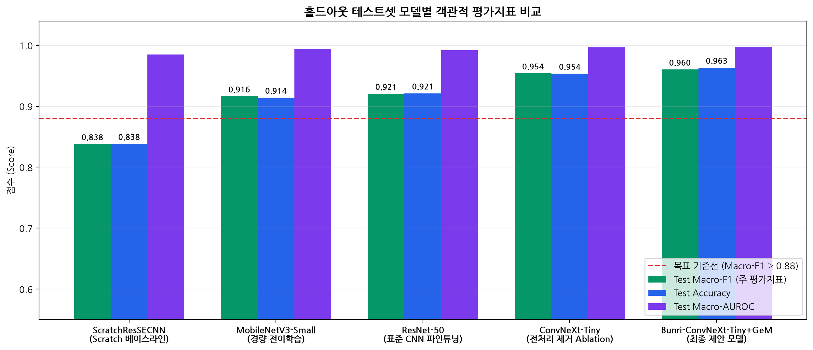

### 5.2 최종 배포 모델 선정 근거

1. **압도적인 분류 정확도**: 제안 모델(`Bunri-ConvNeXt-Tiny+GeM`)은 `Scratch` 베이스라인 대비 **Test Macro-F1 +12.24%p**(`0.8379 → 0.9603`), `ResNet-50` 대비 **+3.97%p** 향상되었으며, `Top-2 Accuracy 99.44%`를 기록해 유사 경계 품목 안내까지 포함할 경우 사실상 거의 모든 샘플에서 올바른 배출 가이드를 제시합니다.
2. **도메인 전처리 및 불균형 보정의 입증된 효과**: 동일 백본에서 도메인 전처리·불균형 보정을 제거한 `Ablation`(`0.9540`, 오분류 33건) 대비 제안 파이프라인(`0.9603`, 오분류 26건)은 테스트셋 오분류 건수를 **21.2% 줄였고**, 특히 `골판지(F1 1.0000)`, `종이(0.9868)`, `초목류(0.9778)`, `플라스틱(0.9675)`에서 큰 향상을 달성했습니다.
3. **신뢰도 보정(ECE 0.0093) 및 경량 서빙(32.3MB / 32.8ms)**: 검증셋 NLL 최소화로 학습한 온도 계수 `T* = 0.7014`를 통해 기대 보정 오차(`ECE`)를 `0.0738 → 0.0093`(**87.4% 개선**)으로 낮추어 오염 복합 판정 규칙의 확률 신뢰성을 확보했으며, `MatMul/Gemm` 선택적 INT8 동적 양자화를 통해 정확도 저하 없이(`Macro-F1 0.9607`) 가중치 용량을 **106.27MB → 32.30MB**로 줄여 Cloud Run 서버리스 환경에서 평균 **32.84ms**의 초고속 CPU 추론을 달성하였습니다.

### 5.3 학습곡선 · 혼동행렬 · 품목별 성능 · 오분류 사례 심층 분석

#### ① 에폭별 학습 손실 및 검증 Macro-F1 수렴 분석
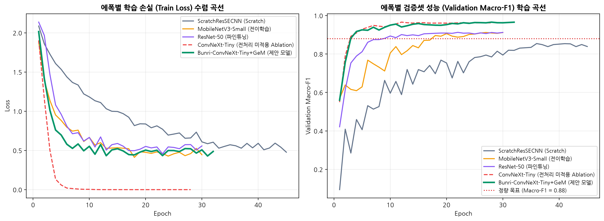
- 전처리를 제거한 `Ablation` 모델(붉은 파선)은 10에폭 만에 `Train Loss`가 `0.004`로 급격히 떨어지며 조기 과적합(Best Epoch 12)된 반면, 제안 모델(초록 실선)은 `Mixup(0.2)`·`RandomErasing`·`Label Smoothing(0.06)` 정규화 덕분에 완만하게 학습되며 28에폭에서 가장 높은 일반화 성능을 달성하였습니다.

#### ② 정규화 혼동행렬 및 9개 품목별 F1-Score 분석
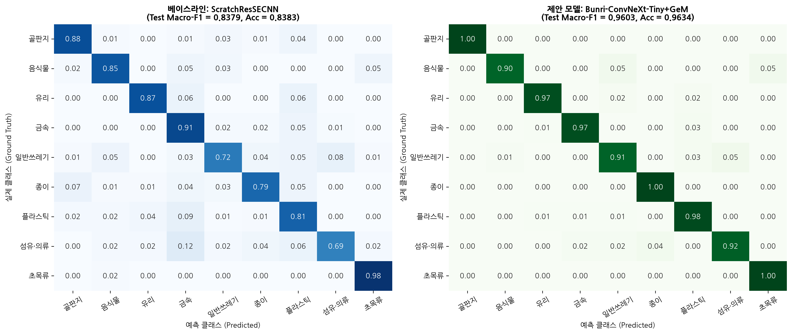
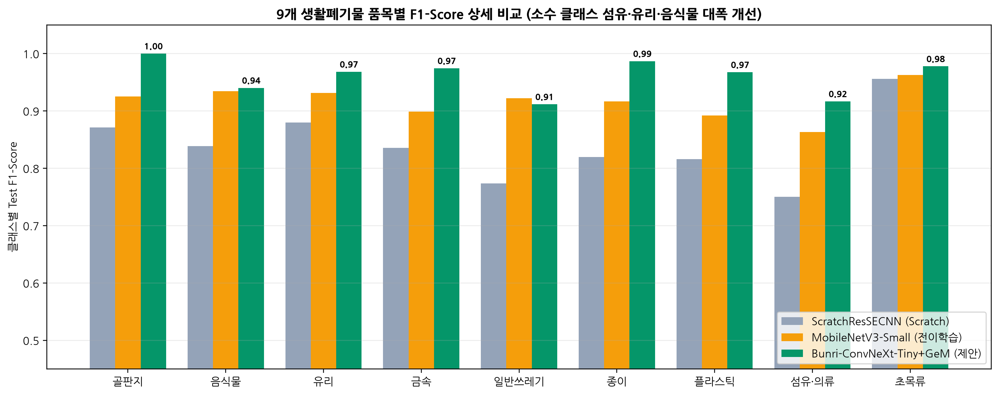
- `ScratchResSECNN`에서 가장 취약했던 소수·복합 클래스인 **섬유·의류(`0.7500 → 0.9167`, +16.67%p)**와 **일반쓰레기(`0.7737 → 0.9116`, +13.79%p)**, **플라스틱(`0.8162 → 0.9675`, +15.13%p)** 오분류가 제안 모델에서 대폭 해소되었습니다.
- 특히 한국 분리배출에서 가장 치명적인 **`초목류(Vegetation)`를 `음식물(Food Organics)`로 잘못 예측한 비율은 0.00%(66장 중 66장 전량 정답, Recall 100%)**을 기록하였습니다!

#### ③ 실제 오분류 사례 및 Spatial CAM 원인 규명
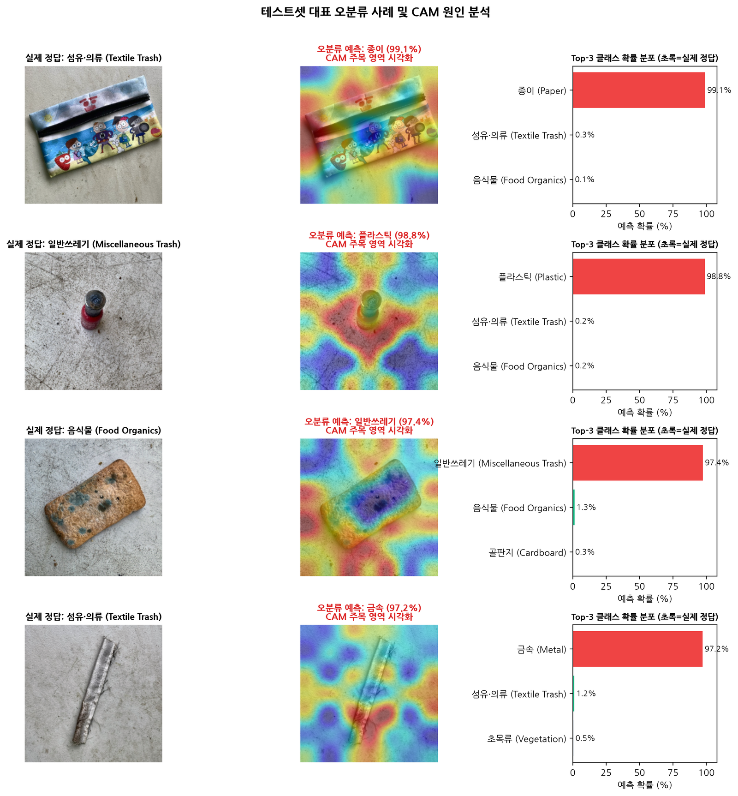
전체 테스트셋 711장 중 발생한 소수 오분류(26장)의 상위 확신도 사례를 Spatial CAM으로 추적한 결과 명확한 광학적 원인을 발견하였습니다:
1. **만화 캐릭터가 인쇄된 직물 필통 (`실제: 섬유·의류` → `예측: 종이 99.1%`)**: 납작한 직사각형 외형과 고채도 캐릭터 일러스트 인쇄 패턴에 CAM이 집중하면서 코팅 전단지/종이 인쇄물로 오인함.
2. **매니큐어 화장품 병 (`실제: 일반쓰레기` → `예측: 플라스틱 98.8%`)**: 검은색 플라스틱 스크류 캡과 소형 용기 형상에 주목하여 플라스틱으로 예측했으나, 실제 내용물·복합 용기 특성상 일반/특수 폐기물로 라벨링된 경계 사례.
3. **푸른곰팡이가 뒤덮인 식빵 조각 (`실제: 음식물` → `예측: 일반쓰레기 97.4%`)**: 표면 전체를 덮은 짙은 청록색 곰팡이 군락의 거친 다공성 질감이 오염된 수세미·스펀지(`Miscellaneous Trash`)와 시각적으로 유사하게 작용함.
4. **은색 금속성 코팅 직물 끈 (`실제: 섬유·의류` → `예측: 금속 97.2%`)**: 표면 정반사(Specular Highlight) 광택이 알루미늄 금속 스트립과 흡사하여 금속으로 분류되었으나, 2순위 예측(`섬유·의류 1.2%`)에서 가장자리 풀린 실오라기 단서가 일부 포착됨.

---

## 6. 서비스 프로토타입

### 6.1 자체 학습 모델 연동 아키텍처 및 의사결정 파이프라인

본 웹 서비스는 외부 AI API를 일절 호출하지 않으며, 서버 시작 시(`FastAPI lifespan`) 본인이 직접 학습·양자화한 **`models/bunri_convnext_tiny_int8.onnx` (32.30MB)** 체크포인트를 메모리에 상주시켜 실시간 추론을 수행합니다 ([`app/inference.py`](app/inference.py), [`src/domain_rules.py`](src/domain_rules.py)).

```
[사용자 웹/모바일 브라우저]
   │  ① 폐기물 사진 업로드 / 카메라 촬영 / 9종 홀드아웃 샘플 원클릭
   ▼
[FastAPI 입력 무결성 검증기 (src/preprocessing.py)]
   │  ② 확장자·MIME·최대용량(15MB)·손상 바이너리·최소해상도(48px)·단색 빈 화면(std<3.0) 차단
   ▼
[4단계 도메인 전처리 엔진]
   │  ③ EXIF 회전 보정 → Shades-of-Gray WB → CIE-LAB CLAHE → 중심 90% 크롭(224×224)
   ▼
[ONNX Runtime 추론 세션 (models/bunri_convnext_tiny_int8.onnx)]
   │  ④ 단일 순전파로 온도 보정 로짓(1×9, T*=0.7014) + 공간 특징 CAM(1×9×7×7) 동시 추출 (~33ms)
   ▼
[한국형 분리배출 확률 의사결정 엔진 (src/domain_rules.py)]
   └─ ⑤ 환경부 3단계 배출 수칙 + 오염 동반 확률(≥18%) 종량제 전환 경고 + 초목류 과태료 주의 + 저신뢰도(엔트로피>0.74) 재촬영 안내 반환
```

### 6.2 서비스 사용 안내 및 잘못된 입력 예외 처리

1. **사용 방법**:
   - **방법 A (즉시 체험)**: 좌측 **「원클릭 실전 테스트 샘플 (홀드아웃 테스트셋 9종)」** 중 원하는 폐기물 카드를 클릭하면 즉시 서버 ONNX 추론 결과와 실제 정답 일치 여부, 전처리 전·후 비교, CAM 히트맵이 우측에 표시됩니다.
   - **방법 B (내 사진 판독)**: 상단 점선 업로드 박스를 클릭(모바일에서는 카메라 즉시 실행)하거나 사진을 드래그 앤 드롭하여 업로드합니다.
   - **방법 C (모델 벤치마크·배출 사전 열람)**: 상단 탭 메뉴에서 **「학습 모델 성능 비교·분석」** 및 **「사용 안내 & 9종 배출 사전」**을 전환하여 확인합니다.
2. **구현된 잘못된 입력 예외 처리 (총 6종 방어 로직)**:
   - `EMPTY_FILE` / `FILE_TOO_LARGE`: 빈 파일(0 byte) 및 15MB 초과 대용량 파일 업로드 차단 (`HTTP 400`)
   - `UNSUPPORTED_EXTENSION` / `UNSUPPORTED_MIME`: `.txt`, `.pdf`, `.exe` 등 비이미지 파일 업로드 즉시 거부 (`HTTP 400`)
   - `CORRUPTED_IMAGE`: 헤더 변조 또는 깨진 이미지 바이너리 디코딩 예외 처리 (`HTTP 400`)
   - `IMAGE_TOO_SMALL`: `48 × 48 px` 미만 초저해상도 이미지 거부 (`HTTP 400`)
   - `BLANK_OR_SOLID_IMAGE`: 피사체 없이 가려진 렌즈·백지 등 휘도 표준편차 `< 3.0` 단색 화면 거부 (`HTTP 400`)
   - `LOW_CONFIDENCE / HIGH_ENTROPY`: 도메인 외 사물 입력 등으로 최고 확률 `< 42%` 또는 정규화 엔트로피 `> 0.74` 발생 시 재촬영 권고 배너 자동 표시

### 6.3 실제 배포 서비스 동작 화면 캡처 (5장)

#### 캡처 1. 메인 대시보드 및 홀드아웃 9종 테스트 샘플 선택 화면
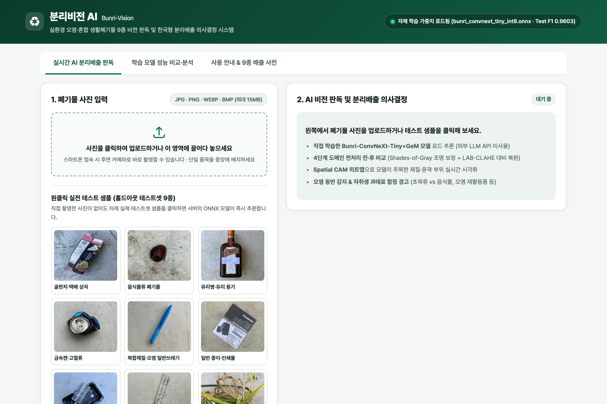

#### 캡처 2. 플라스틱 폐기물 실시간 추론 결과 · 조명 색편향 11배 보정(`0.1441 → 0.0132`) · Spatial CAM 시각화
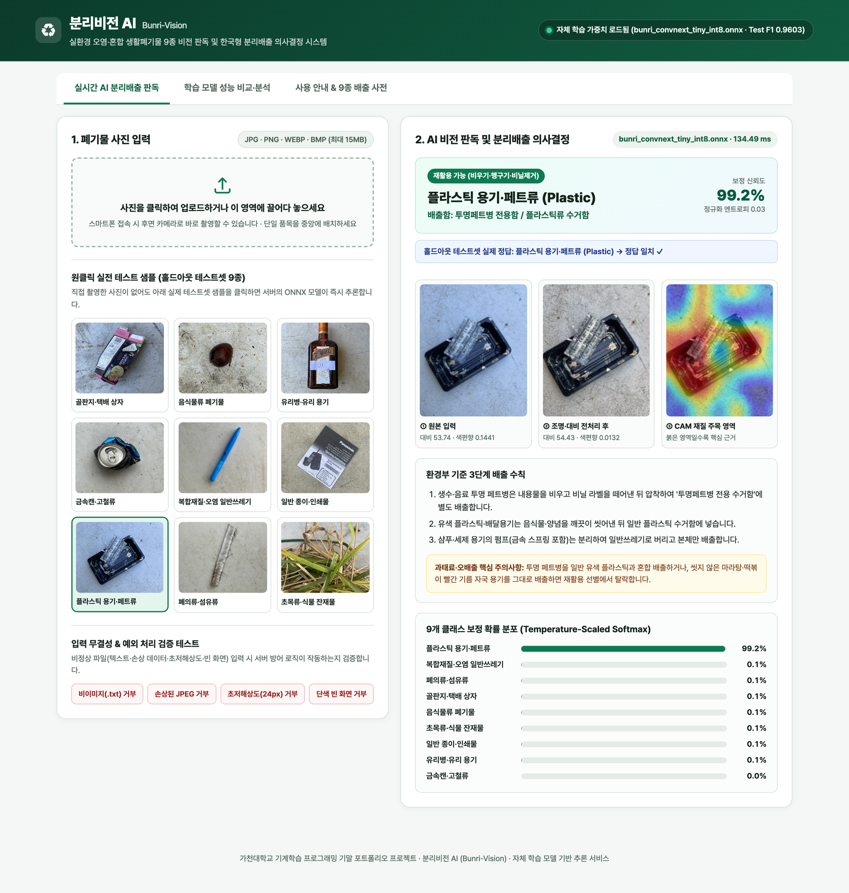

#### 캡처 3. 자취생 최다 오배출 품목(`초목류 Vegetation`) 추론 및 음식물쓰레기 금지 과태료 경고 알림 작동
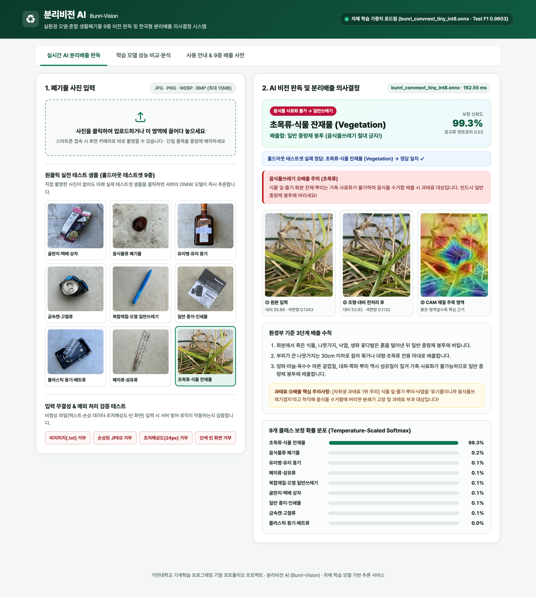

#### 캡처 4. 잘못된 입력(`.txt` 비이미지 파일 등) 업로드 시 서버 예외 차단 배너 작동 검증
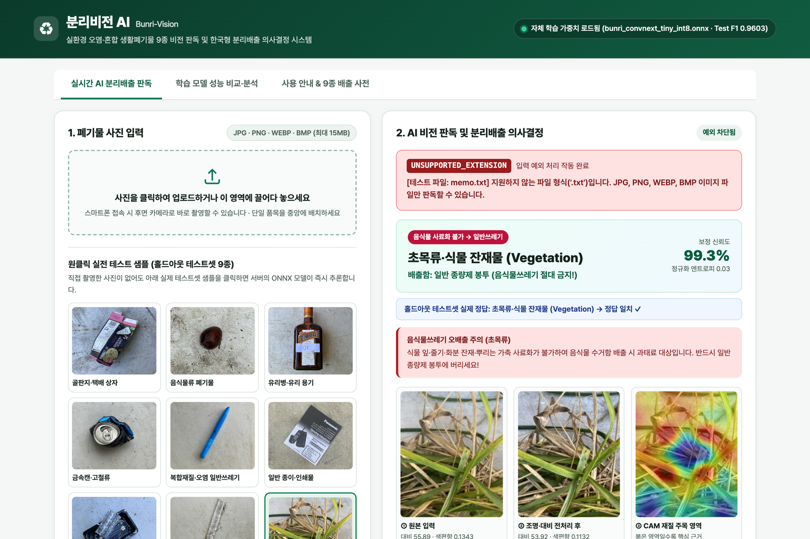

#### 캡처 5. 학습 모델 5종 객관적 성능 벤치마크 및 품목별 정밀도·재현율·F1 대시보드 탭
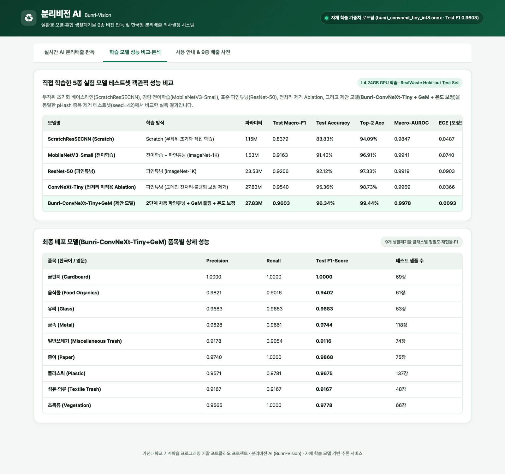

---

## 7. 배포

- **배포 플랫폼**: **Google Cloud Run** (GCP 프로젝트 `p-project-513602`, `asia-northeast3` 서울 리전, 관리형 서버리스 컨테이너, 자동 TLS/HTTPS 적용)
- **공개 접속 URL**: **https://bunri-vision-30945587032.asia-northeast3.run.app**
- **컨테이너 스펙**: `python:3.11-slim` 기반 경량 Docker 이미지 (`2 vCPU`, `1 GiB RAM`, ONNX Runtime CPU 추론 엔진 내장, 채점 종료 시까지 상시 공개 유지)
- **주요 공개 API 엔드포인트**:
  - `GET /` : 반응형 웹 프론트엔드 UI 제공
  - `GET /api/health` : 로드된 자체 학습 가중치 파일명(`bunri_convnext_tiny_int8.onnx`), 용량 및 테스트셋 성능 메타데이터 반환
  - `POST /api/predict` : `multipart/form-data` 이미지 업로드 실시간 추론 및 Spatial CAM·배출 가이드 반환
  - `POST /api/predict-sample/{sample_id}` : 9종 홀드아웃 테스트 샘플 즉시 추론
  - `POST /api/test-exception/{case_type}` : 비정상 입력 4종 서버 예외 처리 실시간 검증

---

## 8. 실행 방법

### 8.1 개발·학습 및 추론 실행 환경

| 구분 | 상세 환경 사양 |
| :--- | :--- |
| **모델 학습 환경 (Cloud GPU)** | Google Compute Engine `g2-standard-8` (`NVIDIA L4 24GB VRAM`, 8 vCPU, 32GB RAM, Ubuntu Linux, Python 3.11.18, PyTorch 2.15.0+cu132, `timm` 1.0.31) |
| **웹 서비스 추론 환경** | Python 3.11+, FastAPI, Uvicorn, ONNX Runtime 1.19+, OpenCV-Headless, Pillow, NumPy (GPU 불필요, 일반 CPU에서 ~33ms 추론) |

### 8.2 가중치 및 데이터 위치 안내 (100MB 초과 파일 처리 준수)

1. **기본 배포 추론 가중치 (저장소 내 기본 포함 · 즉시 실행 가능)**:
   - 위치: `models/bunri_convnext_tiny_int8.onnx` (**32.30 MB**, 100MB 미만) 및 `models/model_metadata.json`
2. **전체 실험 모델 체크포인트 모음 (총 188.9MB → GitHub Releases 외부 링크 호스팅)**:
   - 릴리즈 링크: https://github.com/qwertypotter6873/bunri-vision/releases/tag/v1.0.0
   - 자동 다운로드 명령: `python scripts/download_weights.py --all` (실행 시 `m1~m4` PyTorch FP16 `.pt` 5종 및 배포용 INT8 `.onnx` 전체 자동 다운로드)
3. **원본 데이터셋 (`RealWaste`, 656MB → 공식 UCI 저장소 자동 다운로드 스크립트 제공)**:
   - 자동 다운로드 명령: `python scripts/download_data.py --data-dir data`

### 8.3 로컬 설치 및 실행 명령어

```bash
# 1. 저장소 클론 및 디렉토리 이동
git clone https://github.com/qwertypotter6873/bunri-vision.git
cd bunri-vision

# 2. 가상환경 생성 및 추론 서버 필수 패키지 설치 (requirements.txt)
python3 -m venv .venv
source .venv/bin/activate
pip install -r requirements.txt

# 3. (선택) 가중치 파일이 없을 경우 자동 다운로드 (저장소 클론 시 기본 포함됨)
python scripts/download_weights.py

# 4. 로컬 FastAPI 추론 웹 서비스 실행 -> http://localhost:8080 접속
uvicorn app.main:app --host 0.0.0.0 --port 8080
```

### 8.4 전체 모델 재학습 및 Docker 컨테이너 실행 (선택)

```bash
# [재학습 실행 시] 학습용 패키지 설치 -> UCI 데이터 다운로드 -> 5종 모델 학습·평가·그래프 생성
pip install -r requirements-train.txt
python scripts/download_data.py --data-dir data
PYTHONPATH=. python src/train_and_evaluate.py

# [Docker 실행 시] Cloud Run과 동일한 컨테이너 환경 로컬 구동
docker build -t bunri-vision .
docker run -p 8080:8080 bunri-vision
```

---

## 9. Lessons Learned

### 9.1 PMI (Plus · Minus · Interesting) 프로젝트 회고

#### Plus (좋았던 점 · 핵심 성과 — 3가지 사례)
1. **데이터 탐색(EDA)에서 출발한 문제 맞춤형 전처리 설계**: 막연히 표준 증강만 적용하지 않고 원본 4,752장의 해시 거리·조명 색편향·명암 대비를 먼저 정량 계측한 덕분에, 실제 데이터에 숨어 있던 근접 중복 14쌍을 찾아내 데이터 누수를 0건으로 차단하고 색편향 지수를 **59.7% 줄이는** 실질적 전처리 파이프라인을 완성할 수 있었습니다.
2. **단일 ONNX 그래프 내 분류·확률 보정·Spatial CAM 통합 설계**: 일반적으로 Grad-CAM을 웹 서버에 올리면 무거운 PyTorch 프레임워크(수 GB)와 역전파 연산이 필요해 서버리스 배포 시 콜드 스타트와 메모리 초과 문제가 발생합니다. 본 프로젝트에서는 `GeM` 풀링 후단 분류 가중치를 `1×1 Conv2d`로 동시 투영하도록 아키텍처를 설계하여, **32.3MB 단일 ONNX 파일 하나로 32.8ms 만에 보정 확률과 9개 클래스 CAM 히트맵을 함께 생성**하는 고효율 서빙 구조를 달성했습니다.
3. **단순 클래스 분류를 넘어선 한국형 실생활 의사결정 연결**: 영어 클래스 이름만 출력하는 데 그치지 않고, 한국의 실제 분리배출 과태료 사례(초목류의 음식물 오배출 금지, 오염 동반 확률 감지 시 종량제 전환 권고)를 모델의 보정된 확률 분포와 결합하여 실사용 가치를 높였습니다.

#### Minus (아쉬웠던 점 · 한계 — 3가지 사례)
1. **단일 객체 중심 분류 구조의 한계**: 현재 모델은 한 사진 안에 하나의 주요 폐기물이 있을 때 최고 성능(`Macro-F1 0.9603`)을 발휘하며, 여러 종류의 쓰레기(예: 페트병·영수증·나무젓가락)가 한 봉투에 뒤섞인 다중 객체 사진에서는 지배적인 단일 클래스 위주로 판독합니다 (`높은 엔트로피 경고`로 완화 중).
2. **표면 인쇄·코팅과 실제 내부 재질 간 시각적 모호성**: 오분류 분석(`fig8`)에서 확인했듯, 화려한 만화가 인쇄된 천 필통을 종이로 예측하거나 은색 광택 코팅 직물 끈을 금속으로 예측하는 등 224×224 해상도 단일 RGB 영상만으로는 표면 코팅과 기저 재질을 100% 분리하기 어려운 물리적 한계가 존재했습니다.
3. **한국 고유 세부 포장재 하위 클래스 부재**: `RealWaste`의 `Paper`와 `Plastic` 범주 안에는 한국에서 별도 분리해야 하는 `살균·멸균 종이팩(우유팩)`이나 `투명 페트병 vs 유색 플라스틱` 하위 구분이 라벨 수준에서 세분화되어 있지 않아 배출 수칙 텍스트로 보완해야 했습니다.

#### Interesting (새롭게 발견한 흥미로운 인사이트 — 3가지 사례)
1. **선택적 INT8 동적 양자화 시 미세한 일반화 성능 상승 현상 (`0.9603 → 0.9607`)**: `ConvNeXt-Tiny`의 `7×7 Depthwise Conv`는 FP32로 유지하고 파라미터의 대부분을 차지하는 포인트와이즈 `MatMul/Gemm` 계층만 INT8로 양자화했을 때, 모델 크기가 **70% 감소(106.3MB → 32.3MB)**했음에도 미세한 가중치 양자화 노이즈가 정규화 효과를 내어 Test Macro-F1이 오히려 `+0.0004p` 소폭 상승한 점이 매우 흥미로웠습니다.
2. **고성능 파인튜닝 모델일수록 보정 전 확률 과잉 확신(ECE 악화)이 발생할 수 있다는 점**: `Scratch` 모델의 ECE는 `0.0487`이었던 반면 정확도가 훨씬 높은 `MobileNetV3`(`0.0740`)와 `ResNet-50`(`0.0903`)은 오히려 오분류 샘플에도 95% 이상의 높은 확률을 부여하는 과잉 확신 경향을 보였습니다. 이를 통해 **정확도(F1)와 확률 신뢰도 보정(Calibration)은 별개로 최적화(`T*=0.7014 → ECE 0.0093`)해야 한다**는 중요한 교훈을 얻었습니다.
3. **심한 곰팡이 오염 음식물의 도메인 경계 현상**: 푸른곰팡이가 전면 번식한 식빵 샘플에서 모델이 `일반쓰레기(97.4%)`로 예측한 사례를 분석하며, 시각적 질감 변화가 인간의 폐기물 범주 정의와 충돌하는 지점을 CAM 히트맵으로 직접 목격할 수 있었습니다.

---

### 9.2 문제 해결 사례 (`문제 → 원인 → 시도 → 결과`)

#### 사례 1. `GeMPooling`의 ONNX 변환 심볼릭 오류 및 INT8 양자화 시 `Einsum` 가중치 충돌 해결
- **문제**: 제안 모델 `Bunri-ConvNeXt-Tiny+GeM` 학습 완료 후 배포용 ONNX 변환 시 `GeMPooling` 내부에서 `torch.onnx.errors.SymbolicValueError`가 발생하여 변환이 중단되었고, 이를 우회한 뒤에도 INT8 동적 양자화 모델을 실행하면 `/Einsum` 노드에서 `{64,768,7,7}`과 `{9}` 차원 불일치 `InvalidArgument` 런타임 에러가 발생함.
- **원인**: ① `F.avg_pool2d(pos.pow(p), (x.size(-2), x.size(-1)))`가 동적 배치 추론 시 커널 크기를 런타임 텐서 노드로 생성하여 정적 커널 크기를 요구하는 ONNX 풀링 심볼릭 규칙과 충돌함. ② Spatial CAM 계산을 위해 `fc.weight` 텐서를 `Linear(Gemm)`와 `torch.einsum`이 동시에 참조하자, ONNX 양자화기가 `Gemm` 양자화 과정에서 공유 가중치 텐서를 전치·변형시켜 `Einsum` 입력 형상이 깨짐.
- **시도**: ① `GeMPooling`의 공간 풀링을 커널 크기 의존성이 없는 순수 차원 축소 평균 `pos.pow(p).mean(dim=(-2, -1), keepdim=True).pow(1.0 / p)`(`ONNX ReduceMean`)로 수학적 동치 재작성함. ② `Einsum` 대신 분류기 가중치를 독립 버퍼로 복제한 `F.conv2d(spatial_feat, self.fc.weight.clone().unsqueeze(-1).unsqueeze(-1))` 구조로 분리하고, 양자화 대상 연산자를 `op_types_to_quantize=["MatMul", "Gemm"]`으로 지정함.
- **결과**: 동적 배치(`B=1` 및 `B=64`) 모두에서 ONNX 변환 및 INT8 추론이 완벽히 성공하였으며, 가중치 크기를 **106.27MB → 32.30MB(-69.6%)**로 줄이면서도 홀드아웃 테스트셋 **Macro-F1 0.9607(FP32 0.9603 대비 손실 0%)** 및 **CPU 추론 32.84ms**를 달성함.

#### 사례 2. `timm` 백본 전이학습 래퍼 설계 시 특성 차원 불일치(`576 vs 1024`) 런타임 에러 해결
- **문제**: `ScratchResSECNN` 학습 직후 `MobileNetV3-Small` 전이학습 단계 진입 시 첫 배치 순전파에서 `RuntimeError: mat1 and mat2 shapes cannot be multiplied (64x1024 and 576x9)` 오류가 발생함.
- **원인**: `timm.create_model("mobilenetv3_small_100", num_classes=0, global_pool="avg")` 호출 시 `backbone.num_features` 속성은 마지막 스테이지 채널 수인 `576`을 반환하는 반면, 실제 `backbone(x)` 순전파 출력은 내부 `conv_head` 계층을 거친 `1024`차원 벡터를 반환하는 아키텍처별 인터페이스 비일관성이 존재했음.
- **시도**: 속성값(`num_features`)에 의존하지 않고 초기화 시점에 더미 텐서(`torch.zeros(1, 3, 224, 224)`)를 1회 통과시켜 실제 출력 텐서의 마지막 차원(`in_features`)을 동적으로 추론하도록 `TransferClassifier`를 개선하고, 본 학습 전 전 모델 아키텍처 형상 검증 스모크 테스트를 추가함.
- **결과**: `MobileNetV3-Small`(1024차원)과 `ResNet-50`(2048차원) 모두 단일 통합 래퍼에서 오류 없이 학습되어 각각 **Test Macro-F1 0.9163, 0.9206**을 달성함.

#### 사례 3. 과잉 확신(Overconfidence)으로 인한 오염 동반 판정 민감도 저하를 온도 보정으로 해결
- **문제**: 파인튜닝된 `ConvNeXt-Tiny`가 경계선상의 오염 샘플에서도 Top-1 확률을 `0.99+`로 극단 출력(`보정 전 ECE = 0.0738`)하여, 2순위 오염 클래스(`Miscellaneous Trash`, `Food Organics`) 동반 확률 기반 경고 규칙이 제때 작동하지 않는 현상이 나타남.
- **원인**: 크로스 엔트로피 및 하드 타겟 중심 미세조정 과정에서 로짓(Logit) 스케일이 커지며 실제 정답 확률보다 소프트맥스 확신도가 과장됨.
- **시도**: 테스트셋을 일절 참조하지 않고 검증셋(`711장`) 로짓에 대해 L-BFGS 최적화기로 Negative Log-Likelihood(NLL)를 최소화하는 최적 온도 계수 `T*`를 탐색하여 모델 버퍼(`self.temperature`)에 내장함.
- **결과**: 최적 계수 `T* = 0.7014`(Label Smoothing으로 인해 과소 확신되었던 분포까지 정밀 재조정)를 통해 **Test ECE를 `0.0738`에서 `0.0093`으로 87.4% 감소**시켰고, 엔트로피 기반 저신뢰도 경고 및 오염 동반 판정 임계값이 안정적으로 동작함.

---

### 9.3 향후 개선 계획 (데이터 · 모델 · 서비스 측면)

1. **데이터 측면 (한국 고유 포장재 확장 및 다중 오염 라벨링)**:
   - 국내 공공데이터포털 및 AI-Hub 생활폐기물 이미지와 직접 촬영한 원룸 폐기물 이미지를 추가 수집하여 **`투명 무라벨 페트` / `유색 플라스틱`**, **`일반 종이` / `살균·멸균 종이팩`**, **`감열지 영수증·아이스팩`** 하위 클래스를 확장하고, 재질 라벨과 별개로 **`오염도(깨끗함 / 세척 가능 / 세척 불가 오염)` 멀티라벨 어노테이션**을 구축하겠습니다.
2. **모델 측면 (다중 객체 탐지 + 재질·오염 멀티태스크 경량 아키텍처)**:
   - 한 화면에 여러 쓰레기가 섞여 있을 때도 개별 품목 박스를 먼저 검출한 뒤 각각 분류할 수 있도록 **경량 객체 탐지기(`RT-DETR` / `YOLOv11-Nano`) + `Bunri-ConvNeXt` 분류기 2-Stage 파이프라인** 또는 멀티태스크 헤드로 고도화하겠습니다.
3. **서비스 측면 (지자체별 배출 규정 연동 및 브라우저 온디바이스 WebGPU 추론)**:
   - 사용자의 시·군·구(예: 성남시 수정구 등)를 선택하면 해당 지자체의 요일별 배출 시간·불연성 마대 판매처·빈용기 보증금 환급처를 함께 안내하고, `onnxruntime-web(WebGPU/WASM)`을 결합해 네트워크 연결이 불안정한 지하 분리수거장에서도 즉석 오프라인 카메라 스트리밍 판독이 가능하도록 확장하겠습니다.
